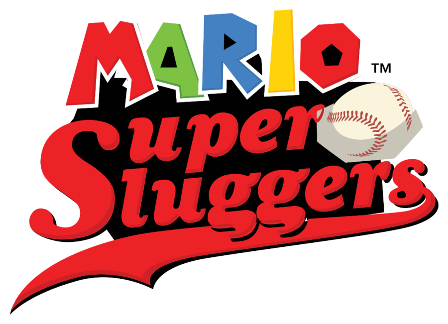

# Super Sluggers Patch

Play **Mario Super Sluggers** (Wii, USA `RMBE01`) with a **Classic Controller**
or a **GameCube controller** instead of the Wii Remote's motion controls.

The patch is applied to your own copy of the game: drop a clean `.wbfs` or
`.iso` onto the patcher and play the result on a Wii (USB loader) or in
Dolphin. Nothing from the game is included in this repository.

## Status

Work in progress. Tested so far in Dolphin with scripted input:

- Classic Controller: menus (D-pad and buttons), the title screen, batting
  swing (R)
- Not yet verified: shake/dash, throwing, pitching, running, the star swing,
  and the GameCube pad (polled straight from the SI hardware)
- **Not tested on a real Wii**

**Known limits:**

- a Wii Remote must still be connected for each player; the Classic Controller
  plugs into it, a GameCube pad needs the remote left bare
- plug the GameCube pad in before starting the game
- the game's pitching motion is still approximated

## Controls

The game only knows the Wii Remote, so every motion is replayed from a recorded
accelerometer waveform when you press the matching button.

| Classic Controller | GameCube | Action |
| --- | --- | --- |
| A / B | A / B | A / B |
| X / Y | X / Y | Wii Remote 2 / 1 |
| + / − / Home | Start | + / − / Home |
| D-pad, left stick | D-pad, stick | Menus, movement |
| R | R | Swing the bat · throw |
| L | L | Shake (dash) |
| ZR / ZL | Z / C-stick down | Pitch: wind up / throw |

## Install

Pick one:

1. **Patcher (GUI):** run `Sluggers-Patcher`, drop your `.wbfs`/`.iso` on it.
   The original is kept as `<name>.bak`.
2. **Command line:** `python3 tools/patch_disc.py "Mario Super Sluggers (USA).wbfs"`
   (needs [wit](https://wit.wiimm.de/) on `PATH`).
3. **Gecko codes:** `codes/RMBE01.ini` (Dolphin) or `codes/RMBE01.txt`.
4. **Riivolution:** `riivolution/RMBE01.xml`.

The Gecko and Riivolution forms keep helper routines in low memory at
`0x80001820-0x80003000`; use the patched disc on a real Wii instead of a
loader's own Gecko handler.

## How it works

See [docs/TECHNICAL.md](docs/TECHNICAL.md). The sources are in `src/`, and
`tools/gen_prebuilt.py` rebuilds `tools/prebuilt/ctl_RMBE01.json` from them
(needs the retail `main.dol`). `tools/build.py` regenerates `codes/` and
`riivolution/`; `tools/check.py` verifies everything is consistent.

## License

MIT, see [LICENSE](LICENSE).
